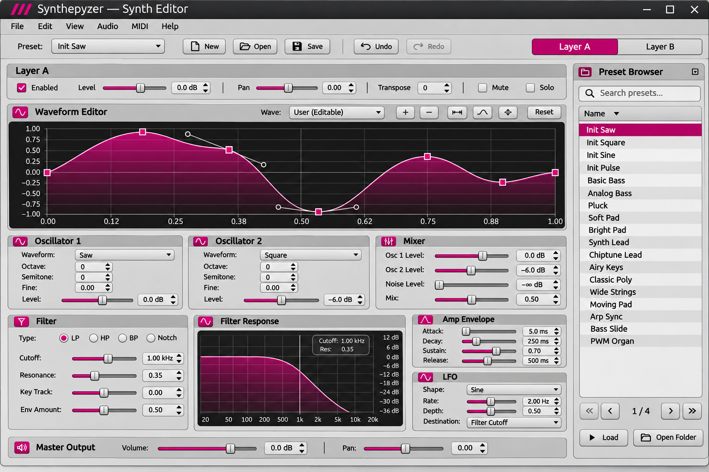

# Synthepyzer

Synthepyzer is a **two-layer PyQt6 desktop subtractive synthesizer**. Its Qt control panel, state binding, undo/redo, file browser and versioned .spyzr presets exist today. **Live audio and MIDI backends are not yet connected.** The approved sound-engine direction is **pyo 1.1.0**; it will be integrated in a later implementation milestone.

## Approved design and Codex handoff

The PNG above is the **approved visual reference**, not evidence the interactive graph or audio engine is already working. Use these maintained specifications before editing code:

- [Codex implementation plan](docs/development/CODEX_IMPLEMENTATION.md) — ordered milestones, tests and no-regression rules
- [Approved UI contract](docs/development/APPROVED_UI.md) — visual tokens, slider layout, interaction and navigation
- [Feature audit](docs/development/FEATURE_AUDIT.md) — implemented versus proposed features, parameter inventory
- [Audio engine decision](docs/development/AUDIO_ENGINE.md) — pyo selection, architecture, DSP mapping, licensing

The UI uses neutral grey panels, magenta #C2187A interactive accents, native horizontal Qt sliders with rectangular handles, permanent bordered groups, Layer A/B navigation, **no collapsible sections and no scrollbars**. Generated example labels, dB and Hz units and preset names do **not** override the actual parameter model.

## Run the desktop shell

    python3 -m pip install -e '.[ui]'
    python3 -m synthepyzer.app

## Run all automated tests

    QT_QPA_PLATFORM=offscreen python3 -m unittest discover -s tests -v

## Read the user manual

From the repo root:

    python3 -m http.server 8000

Open http://localhost:8000/docs/ . This manual describes the intended instrument, including some future audible and MIDI behaviours; the current application is a UI/state/preset foundation until pyo integration is complete.

## File format

The model supports two independently editable layers and versioned, human-readable .spyzr JSON presets. The current format version is 1. Older single-layer v0 patches migrate forward. Loading unsupported future versions fails safely and unrelated unknown fields are retained. Do not change this contract without a versioned migration and tests.
