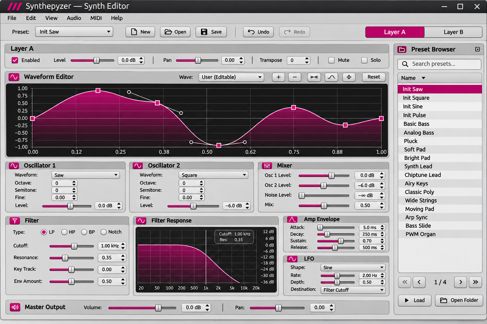

# Synthepyzer docs

This folder contains **both** the user-facing HTML/Markdown manual and development contracts for Codex. The current PyQt6 shell has working state editing, undo/redo and .spyzr preset support, but **audio/MIDI and interactive waveform editing remain planned**, despite their appearance in the approved mockup.

## Approved UI screenshot

The original 1536×1024 PNG is committed under assets/synthepyzer-approved-ui.png. Do not regenerate it, confuse visual examples with existing controls, or infer fictitious factory presets from it.

## Developer documentation

- [Codex implementation instructions](development/CODEX_IMPLEMENTATION.md)
- [Approved UI contract](development/APPROVED_UI.md)
- [Feature implementation audit](development/FEATURE_AUDIT.md)
- [Selected pyo audio engine and DSP plan](development/AUDIO_ENGINE.md)

## User manual

The user-facing manual is static. From the repository root, run:

    python3 -m http.server 8000

Then open http://localhost:8000/docs/ . Manual content is in content/, the site renderer in markdown.js and no Node/build dependencies are needed. Where the manual describes how to play audio via a MIDI controller, treat that as the *finished-product workflow* pending engine and MIDI implementation.
