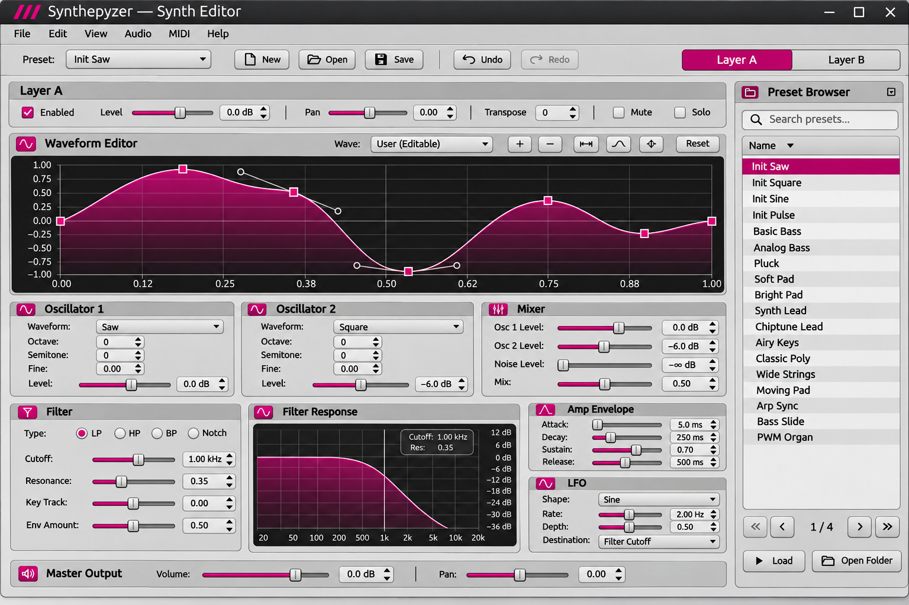

# Synthepyzer — approved desktop UI contract

Status: **APPROVED VISUAL DIRECTION / NOT A REPRESENTATION OF IMPLEMENTED BEHAVIOUR**  
Updated: 2026-11-11

Full-resolution asset: [docs/assets/synthepyzer-approved-ui.png](../assets/synthepyzer-approved-ui.png) (1536 × 1024). This exact image is the approved visual reference. Do not silently replace it with a newly generated mockup.

## Authoritative order

1. Existing parameter paths, persisted preset schema, state bindings and tests define **what already exists**.
2. This document defines the **desired appearance and interactions**, including specified future capabilities.
3. The raster reference defines **visual composition and proportions**, not the truth of example text, values, available presets, waveform types, or signal processing.
4. [Feature audit](FEATURE_AUDIT.md) separates working, scaffolding, and proposed functionality. [Codex plan](CODEX_IMPLEMENTATION.md) defines the implementation sequence.

Never implement invented screenshot content just because it appears in the artwork.

## Non-negotiable visual rules

- Product name: **Synthepyzer**, spelled exactly. Window title: "Synthepyzer — Synth Editor" optionally prefixed by preset/dirty marker.
- Standard **PyQt6 widgets** and Qt-style desktop UI. Do not swap to a web frontend or introduce a secondary UI framework.
- Neutral light-to-medium **grey chrome**, defined panel outlines, subtle raised control group headers, dark near-black waveform/response plots.
- Accent: **magenta #C2187A**, not orange and **never green**. Use magenta for active slider fill, selected layer/tab, selected list item, plotted line, editable nodes, and active focus/checkbox state; keep text contrast strong. Supporting palette: canvas #C3C3C3, panels #D0D0D0, thin outlines #858585, text #202020, graph #18191B, graph grid #48484C, graph trace #E8E8E8, graph magenta fill #C2187A with translucency. Harmonize with native Qt widget theme when needed.
- Preferred controls are **thin horizontal sliders with narrow rectangular grey handles**, aligned in repeated rows: name | slider | numerical spinbox. No oversized novelty knobs. Wheel/touch step and keyboard input must work.
- Permanently **visible, bordered groups**: Layer utilities, Oscillator 1, Oscillator 2, Mixer, Filter, Amp Envelope, LFO, Master Output. No collapsible sections or expand/collapse controls.
- **NO SCROLLBARS ANYWHERE**, including page, panel, dock, chart, and preset browser. Existing preset pagination remains; tabs or deliberate responsive reflow are allowed. No overflow, clipping, or overlapping controls. Check 1000 × 680, 1180 × 760, and 1536 × 1024 Qt client geometry; factor window decorations and device scale.
- Avoid repeating editor values in separate captions. Label on the left, editor and one live value to the right; toggles, combos, and spinboxes already show their values. Keep labels concise but unambiguous.
- Reset buttons should be present only where they perform real state edits. Avoid sprinkling a tiny reset icon beside every control if it makes the panel noisy; a context-menu Reset Parameter may replace per-control decoration, preserving undo/redo.
- No mockup-only playback, CPU meter, audio meter, active voice count or preset catalog until their actual backing functionality exists.

## Navigation: what is a "scene"?

There is currently **no Scene object or scene switcher in the repo**. Do not invent scenes or an arrangement/sequencer/sampler interface.

- **Layer A / Layer B**: persistent top navigation, selecting one of two fully independent synth layers; does not turn either layer on/off.
- **Graph mode**: when implemented, clearly labeled buttons/tabs **Waveform | Filter Response | LFO Shape** select what is displayed in the large graph region. The selected mode is UI-only navigation, not another layer, scene, preset, or patch.
- **Target oscillator**: Waveform editing must show an unambiguous **OSC 1 / OSC 2** target selector in the active layer. No single unscoped waveform state.
- **Presets**: files, not scenes. Select a preset, then explicitly Load; ask before discarding unsaved edits. Scrolling list is replaced by paging controls.
- **View menu**: Preset Browser toggle stays. No Expand/Collapse menu items.

## Window anatomy

1. Native app menu: File, Edit, View, Audio, MIDI, Help. Keep existing working actions.
2. Tight utility toolbar: current patch name, New, Open, Save, Undo/Redo and clearly highlighted Layer A/B selector; unused mockup widgets must not appear.
3. Layer utilities: enabled, level, pan, transpose, mute, solo.
4. Major waveform/analysis panel: dark gridded canvas, graph-mode switch, target selection, edit tools when applicable. A large useful visualization, not a tiny decorative preview.
5. Paired oscillator sections (waveform, octave, semitone, fine, level), mixer with actual existing controls; keep all semantically grouped.
6. Filter settings + filter response plot, AMP envelope, LFO. Filter type supported by current model is lowpass/highpass/bandpass/notch.
7. Master output, status region only for actual status; keep lower border visible.
8. Optional right dock: searchable preset browser with Previous/Next page and explicit Load / Open Folder.

Use flexible QGridLayout, QHBoxLayout, QSizePolicy and compact breakpoints where necessary. At smaller dimensions, keep every widget reachable without scrolling by changing which graph mode occupies the primary canvas and using a clearly labeled tabbed *workspace* if full simultaneous display cannot fit. Do not collapse permanent parameter groups or hide controls without explicit navigational access.

## Interactive plots: design contract, not currently implemented

### Waveform editor

- Render phase X in 0..1 and amplitude Y in -1..+1 using QWidget + QPainter (or QGraphicsView without scrollbars).
- Graph consists of editable knots and, if chosen, tangent handles; pointer drag changes the actual source data. Distinct hit targets, pressed/hover states, clipping and bounds, keyboard support, reset, undo/redo. Do not let points cross or introduce discontinuities at the periodic wrap unless explicitly configured.
- Preset waveforms remain choices from the model. Add a dedicated "Custom" waveform only with a versioned state/preset migration and a DSP wavetable path; never show "User (Editable)" without implementation.
- Dragging in the plot creates one undoable gesture, not hundreds of undo steps; do not send blocking DSP rebuild work on every mouse-move event. Throttle/render cheaply and hand off normalized samples safely.
- Make the graph target (Layer A/B, Oscillator 1/2) visible to avoid accidentally mutating the wrong sound.

### Filter response

- Display an actual theoretical response from the **same coefficients/parameters** as the active DSP filter. X is log frequency in Hz, Y is dB response. It is a transfer-function visualization, not a directly arbitrary editable waveform.
- Drag cutoff horizontally, resonance vertically or with a dedicated handle. Update filter parameters through StateController, obey their bounds, and make control/plot updates bidirectional. Type selectors: LP, HP, BP, Notch.
- Do not paint an arbitrary LP curve if a HP/BP/notch mode is selected; the graph must correspond to current filter type.
- Existing stored cutoff/resonance values are normalized 0..1; see engine contract for explicit unit mapping. Do not print "1.00 kHz" over a raw 0.72 without a conversion rule.

### LFO shape

- Select the active layer's LFO; preview sine/triangle/saw/square and show rate, depth and destination from the model.
- The plotted shape is read-only for standard named shapes. A drag-editable custom LFO is a **future option** requiring its own state/preset schema, interpolation rules and engine support.
- LFO is bipolar unless a future parameter explicitly adds a unipolar mode. Do not invent sync/phase controls as working features.

## Artwork versus existing code: known mismatches

| In approved artwork | Actual repo contract | Instruction |
| --- | --- | --- |
| "Init Saw" and a long built-in preset list | default patch is "Init Patch"; file browser lists real .spyzr files | Display actual files only; never ship fabricated preset rows |
| "Noise Level" mixer row | mixer has osc1_level, osc2_level, mix only | Remove this mockup-only row |
| dB-labelled osc / mixer / master sliders | persisted values are linear/normalized, displayed as percent | Keep actual units unless formal conversion and tests are added |
| 1.00 kHz cutoff | filter.cutoff is a normalized 0..1 value | Create explicit logarithmic Hz mapping before showing frequencies |
| LFO "Filter Cutoff" routing | state uses destination="filter" | UI may label it "Filter" but preserve state |
| Custom waveform editor with editable points | no waveform editing model, DSP or UI yet | Implement in isolated milestone; do not fake working behavior |
| Many preset names and associated sounds | repository ships no factory sounds | Separate factory preset deliverable if requested |
| Active audio visualizer / graph | no audio backend yet | Render a documented static design placeholder only in design preview, not as functional telemetry |

## Acceptance evidence

Codex must provide before/after screenshots of the **actual running Qt window**, not generated image art, and measured geometry of each visible group for each test size. All 32 layer parameters plus two master controls must remain reachable. Verify label legibility, contrast, slider hit targets, no collisions, no scrollbars, and correct data bindings in both layers. Run all tests; do not claim success on appearance alone.
